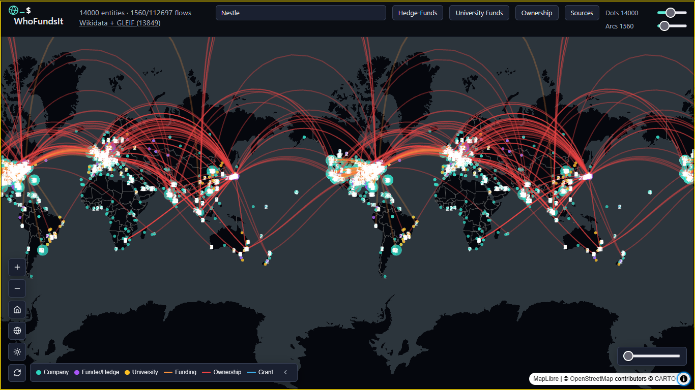

# Who Funds It (?)

## **Live demo: [whofundsit.netlify.app](https://whofundsit.netlify.app)**

Many people might want to know when making a purchase, buying a subscription, or reading a medical study, what the primary incentives are behind the service or who are its prime beneficiaries. The best way to understand this information is to see what funding is behind any company, organization or even an educational institution. For journalists and researchers, this data hides behind [WORD] entries and filings, that take weeks or months to process visually. 

That's why I made WhoFundsIt, an interactive webapp with a global corporate financing map that showcases the flow and source of money, with bigger graphical representation to places with more funds, e.g., BlackRock. Using data from various APIs and databases, stocks, equity, debt and assets are displayed for each company on the map, and relational connections are drawn between disparate companies and holdings agents. 
Business addresses are geocoded to latitude and longitude using OpenStreetMap's Nominatim API, giving an accurate represenation of where the money flows, and from whom.

Additionally, we use the great database over at OpenAlex.org to show the connections between funders and funded educational institutions, by way of the number of total grants provided.

For a full list of the sources used, check [below](#sources-list).

Tracking the data for private companies when available, public and large scale donations, major individual shareholders' information, among others is planned for the future.

An Open-Weight LLM, Muse Glimmer 30B for now - is used for processing hard-to-translate business addresses on the map, and to test the soundness of the data collected using a random verification test on each of the collected datapoints.  
 - Note: This feature is a work in progress. 



## How to run

### Prereqs (for Windows, macOS, Linux)

- Node.js 20+ and npm
- PostgreSQL 14+ with a `whofundsit` database. Easiest on every OS: Docker
  (step 2). Linux/macOS can also run Postgres natively; on Windows use
  Docker Desktop (the native commands below are Unix-only).

### Demo quickstart (~5 minutes, all three OSes)

1. Clone the repo (shallow, to save on space).   
On Windows `cmd.exe` run the npm lines one at a time, it has no `\` continuation.  <br><br>
Manual approval might be needed for the three npm scripts listed:  <br>
   ```bash
   git clone --depth=1 https://github.com/feeRnt/whofundsit && cd whofundsit
   cp backend/.env.example backend/.env
   npm install-scripts approve esbuild @prisma/engines prisma
   npm install
   ```
2. Start Postgres.  <br>
   #### a. Docker (recommended)
   - (Windows/macOS - install Docker Desktop first and keep it running):
    - (Linux - ensure docker is installed and running `sudo dockerd &`):  
Will probably need sudo - - -  
`docker run --name whofundsit-pg -e POSTGRES_PASSWORD=YOUR_PASSWORD -e POSTGRES_DB=whofundsit -p 5432:5432 -d postgres:16`  <br><br>
Already have a `whofundsit-pg` container?   
`docker start whofundsit-pg`.  <br>
   #### b. No-Docker (Linux/macOS only):
   - install the server package first:  <br>
   ```bash
   # Arch:         sudo pacman -S postgresql
   # Debian/Ubuntu: sudo apt install postgresql  (self-initializes; skip initdb)
   # macOS:        brew install postgresql@16    (then follow its initdb hint)
   ```
   - Usermode (no sudo):  <br>
   ```bash
   initdb -D $HOME/whofundsit -E UTF8 --auth=trust
   pg_ctl -D $HOME/whofundsit -o "-p 5433 -k /tmp" -l $HOME/whofundsit.log start
   createdb -h /tmp -p 5433 whofundsit
   ```
   Then open `backend/.env` and set:
   `DATABASE_URL="postgresql://$USER@localhost:5433/whofundsit"`  
   You can alternatively do  
   `echo "DATABASE_URL=postgresql://$USER@localhost:5433/whofundsit" >> backend/.env` <br><br>
   **Port already in use? Find the process**  
   `ss -ltn | grep 5433` (Linux) or  
   `lsof -i :5433` (macOS);  
   and stop the stale server  
   `pg_ctl -D $HOME/whofundsit stop`  
   then start again.
   - With sudo (Linux):  <br>
   ```bash
   sudo -iu postgres initdb -D /var/lib/postgres/data  # Arch only; Debian self-initializes
   sudo systemctl start postgresql
   sudo -iu postgres createuser -s $USER && createdb whofundsit
   ```
   The `.env` default (port 5432) works as-is here.  <br><br>
3. Start the demo (same on all OSes):
   ```bash
   npm run demo
   # Pushes the schema, loads the committed seed dataset, builds, and serves
   # on one port. No API calls are made and uses the dataset shipped
   # in the repo. Answer the LAN question if you want other devices  
   # on your network to reach it.  
   #
   # Note: Calls are made to Yahoo Finance with your IP and `QUOTE_USER_AGENT`  
   # whenever you click on a company, to try and fetch its daily stock +/- change.  
   # Subsequent calls are cached.
   ```
   Re-running into the same database? Prefix `DEMO_WIPE_OK=1` to reseed the database:
   ```bash
   DEMO_WIPE_OK=1 npm run demo
   ```
   Windows:  
   `cmd.exe`: `set DEMO_WIPE_OK=1 && npm run demo`  <br><br>
   Or split the dev servers (two terminals — no `&`; it isn't portable):
   ```bash
   # terminal 1          # terminal 2
   npm run dev:backend   npm run dev:frontend
   ```

4. Open `http://localhost:4000` in a browser:  
 globe/flat-map toggle, click any
   dot for value, address, and EDGAR evidence links. Click on any arcs or projections to see cross-connections between companies.  
   
   On another device on your
   LAN? Answer `y` at the `npm run demo` prompt   
   (or do `npm run dev --prefix frontend -- --host`), then open the  
   `on your LAN:` URL from the startup log instead.
   <br><br>
### Maintainer data refresh

```bash
cd backend
npm run bulk                 # SEC nightly ZIPs -> base layer (one long run, cached)
npm run ingest               # XBRL frames top-up for the current quarter
npm run sync:global          # international companies (Wikidata -> GLEIF) + ownership arcs
npm run industry:global      # industry backfill on lei: rows (Wikidata P452)
npm run industry:sync        # SIC industry backfill from the local archive (offline)
npm run tickers:global       # ticker backfill on lei: rows (ISIN -> OpenFIGI)
npm run regional:esef        # EU/UK facts (optional; ESEF_LIMIT caps it)
npm run regional:twse        # Taiwan facts (optional; TWSE_LIMIT caps it)
npm run flows:openalex       # grant arcs (OpenAlex, cursor-paged, cached)
npm run coords:global        # place lei: rows from Wikidata P625 (before Nominatim)
npm run coords:populate -- --all  # Nominatim geocoding, 1 req/s, biggest first
npm run flows:13f            # fund arcs (all 13F filers; THIRTEENF_MAX_MANAGERS caps it)
npm run names:sync -- --yes  # legal filer names (asks first without --yes; --list previews, --cached reviews past skips)
npm run verify:all           # verify:claims + deadlines:snapshot + db:export (run and leave)
```

#### TODO:
LLM repair loop for ungeocoded rows (needs the Modal server deployed:
`modal deploy backend/formalize_worker.py`,  
`modal deploy backend/inference_worker.py` -   
ensure your .env file has the proper credentials),
```bash
npm run formalize:addresses -- --pass=1   # Glimmer-30B parses DB failures -> llm-pass-1.json
npm run coords:populate -- --llm-1        # Census + structured Nominatim, marks outcomes
npm run formalize:addresses -- --pass=2   # retry prior misses (add --limit=K to cap)
npm run coords:populate -- --llm-2        # ... and so on
```

## Hosting (Neon Postgres + Vercel/Netlify frontend)

Split-origin: the frontend goes on Vercel/Netlify, the PSQL database on Neon, and the
Express backend on any Node host (Render/Railway/Fly/VPS - We used Cloudflare CDN using Wrangler to set persistent backend cache, for high speed and low cost).  
Same-origin `Dockerfile`/compose path stays in [DEPLOY.md](DEPLOY.md). No Docker
needed for this path: Neon replaces the local-Postgres step, and the
backend hosts above take either the image or plain `npm start`.

1. `npm run db:export`, commit the seeds.
2. Create the Neon database and copy its URL **verbatim** (it carries
   `?sslmode=require`). Point local `DATABASE_URL` then run `db:push` + `db:seed` once from your device.
3. Deploy the backend — `Dockerfile` image or `npm start` — on a
   container/process host (Render/Railway/Fly/VPS; Vercel can't run a
   persistent Express server, it hosts only the frontend). Give it
   `DATABASE_URL` (Neon URL), `PORT`, and the existing backend .env variables
   (`MODAL_*`, user-agent ids; no need for `VITE_*`).
4. On Vercel/Netlify: Root Directory: `frontend`, build command: `npm run build`. <br> Environment:
   `VITE_API_URL=https://<backend-host>`. This var is used at build time, so
   rebuild after changing it. You might be prompted automatically. This should be your Cloudflare Worker CDN URL if set up, otherwise the Render/back-end worker URL.  
   Check `cloudflare/.env_wrangler.example`
5. Open the Vercel/Netlify URL and check dots, arcs, popups. You will see an error if the database has failed to load.

Then commit the updated seed files. Log suspected duplicate entries with
`npm run dedupe:report`; delete selected ones with
`npm run merge -- <keepId> <dropId>`.  
The dropped entity's data will be merged into keepId.

## Prompts log

`prompts.md` (the running log of build prompts) is unfinished and removed for now — it will be completed later.

## Scripts reference

All npm scripts and what they do live in [NPM_SCRIPTS.md](NPM_SCRIPTS.md).

## License & credits
Apache 2.0. See LICENSE for the full license text.
  
<a name="sources-list"></a>
All data is courtesy of and thanks to:
- [SEC EDGAR](https://www.sec.gov/edgar) (company facts, 13F holdings),
- [Wikidata](https://www.wikidata.org) (company crosswalk, industries, coordinates),
- [GLEIF](https://www.gleif.org) (LEI records, HQ addresses, corporate subsidiaries),
- [OpenFIGI](https://www.openfigi.com) (CUSIP/ISIN to ticker mapping),
- [OpenStreetMap](https://nominatim.openstreetmap.org) contributors via Nominatim (geocoding),
- the [US Census Bureau](https://geocoding.geo.census.gov) (bulk US geocoding),
- [OpenAlex](https://openalex.org) (grant funders, works, institutions),
- [Yahoo Finance](https://finance.yahoo.com) (day-change quotes),
- [XBRL International](https://filings.xbrl.org) (ESEF EU/UK filings),
- the [Taiwan Stock Exchange](https://www.twse.com.tw) (Taiwan financial facts),
- and [Wikipedia](https://en.wikipedia.org) (index snapshots).

More datasets are planned to come soon!

Please check the licenses/copyright and a detailed usage of the presented data in [LICENSE](LICENSE) and [DATASETS.md](DATASETS.md). They're the real heroes <3

## AI use notice:
This project was made with the help of Muse Code \[95% of codebase\], using Muse-Spark-1.3-Contributor (bulk load of the code, fixes, and real time changes), Muse-Wonder-1.0 (initial architectural planning, implementation and design; cleanups), during the 2026 Meta AI Developer Hackathon running from Oct 26 to November 4.

The code optionally uses the Muse-Glimmer-30B model to formalize broken addresses, and to generate a human-friendly action report on the validity of the displayed data. (Work-in-progress)
